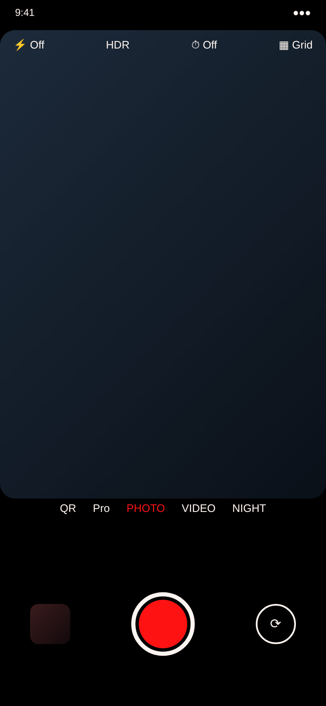
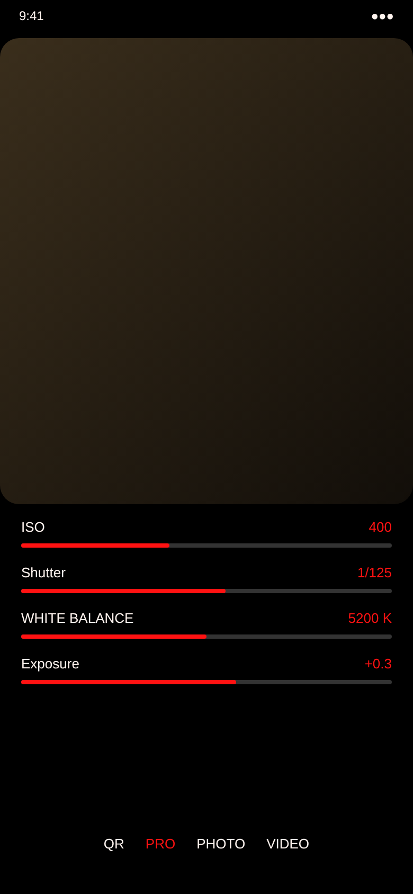
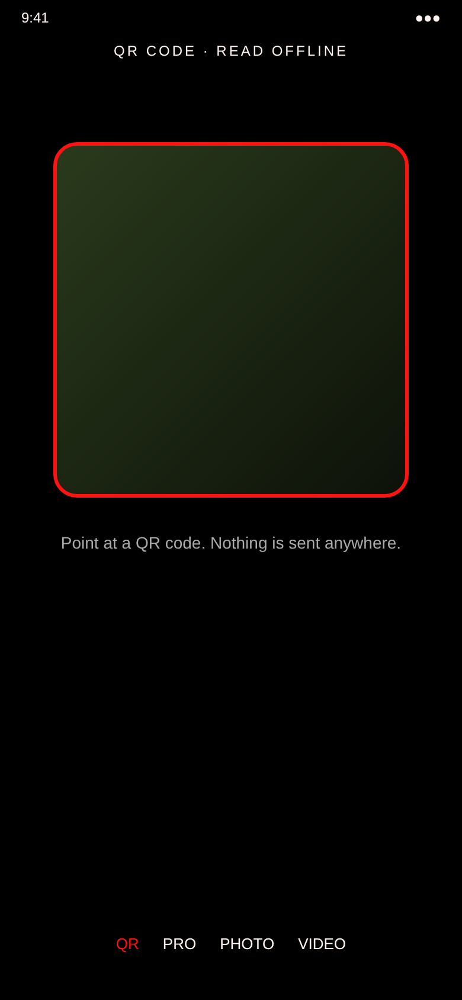
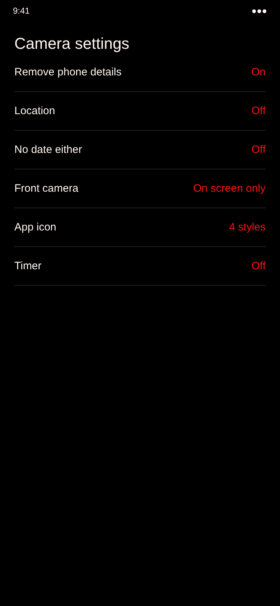

# Camera

A private camera for Android. Fully offline: no internet permission, nothing collected, no background camera.

## Screens

These are design previews. The finished app follows this look.

<table>
  <tr>
    <td></td>
    <td></td>
    <td></td>
    <td></td>
  </tr>
</table>

## Features
- Photo, video, Night, Pro (ISO, shutter, white balance, exposure) and an offline QR scanner
- Flash, zoom, tap to focus, timer, grid lines, HDR where the phone supports it
- **New photos carry no phone details** (maker, model, serial numbers, software) and **no location** unless you turn it on
- Optional **No date either** level with random file names
- **Front camera** opens only while on screen, and can be turned off entirely
- App icon in 4 styles with a color wheel

## Download
1. Open **[Releases](../../releases/latest)**.
2. Download the newest `Camera-build-N.apk`.
3. Open it on your phone and tap **Install**.

Requires Android 10 or newer. MIT license.
